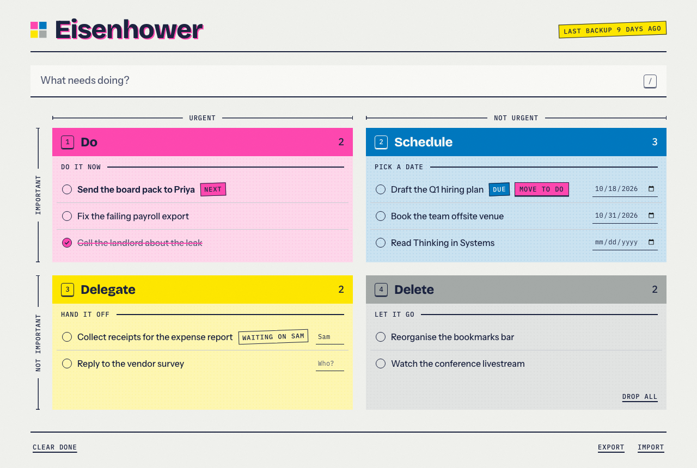

# Eisenhower Matrix

A simple, keyboard-first web app for sorting tasks into the Eisenhower Matrix:
Do, Schedule, Delegate, Delete.

Your tasks are stored only in your own browser. Nothing is sent to a server.



The look ("Riso desk") is specified in [`docs/design.md`](docs/design.md). More screenshots,
in both themes and at phone width, are in [`docs/screenshots`](docs/screenshots). To
regenerate them: `SCREENSHOTS=1 npx playwright test screenshots`.

## Development

```
npm install
npm run dev     # local dev server
npm test        # unit tests (Vitest + jsdom)
npm run e2e     # browser smoke tests (Playwright; first run: npx playwright install chromium)
```

The build plan is in [`docs/plans/v1.md`](docs/plans/v1.md).

## Deploying

Every push to `main` deploys to Cloudflare Pages (project `eisenhower-matrix`), but only after the full CI job passes. The deployed files are the exact build that was tested. The repo needs two Actions secrets: `CLOUDFLARE_API_TOKEN` (an API token with the Account › Cloudflare Pages › Edit permission) and `CLOUDFLARE_ACCOUNT_ID`.
